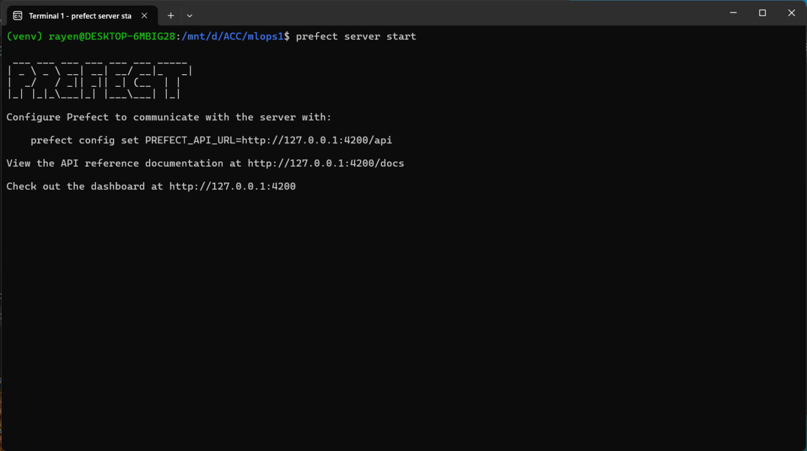
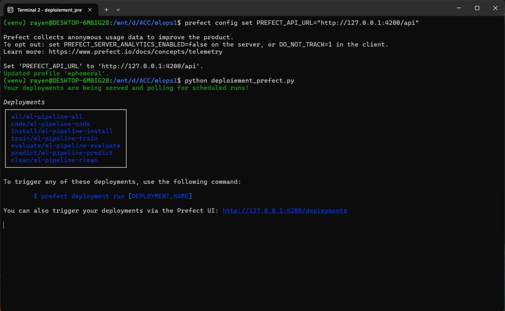
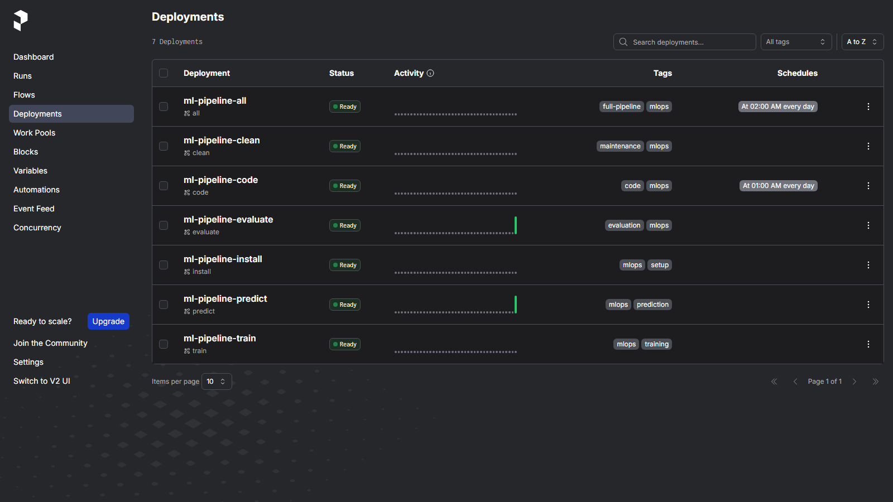

# MLOps – Atelier 3: ML pipeline with Prefect

Predicts whether a diabetic patient will be **readmitted to hospital**, using the
*Diabetes 130-US Hospitals (1999–2008)* dataset. The model code is modular
(`model_pipeline.py` + `main.py`), and every step is orchestrated with **Prefect**:
code checks, data preparation, training, evaluation, prediction, and daily scheduled runs.

## Project structure

```
.
├── data/diabetic_data.csv     # dataset
├── model_pipeline.py          # ML functions: prepare, select, train, evaluate, save, load, predict
├── main.py                    # runs one step of model_pipeline.py from the command line
├── pipeline_prefect.py        # Prefect tasks and flows
├── deploiement_prefect.py     # Prefect deployments + daily schedules
├── tests/                     # unit tests (pytest)
├── screenshots/               # Prefect server, worker and UI screenshots
├── requirements.txt
├── pyproject.toml             # black + pytest settings
└── .flake8                    # flake8 settings
```

Generated files (`artifacts/`, `models/`) are not tracked: the pipeline rebuilds them.

## Setup

Tested on Ubuntu 24.04 (WSL) with Python 3.12.

```bash
python3 -m venv venv
source venv/bin/activate
pip install -r requirements.txt
```

## The model pipeline (`main.py`)

Each step saves its output so the next one can pick it up:

```bash
python main.py prepare    # clean + split the data      -> artifacts/prepared_data.joblib
python main.py select     # ANOVA ∩ Lasso features      -> artifacts/selected_features.joblib
python main.py train      # train XGBoost (--optimize to tune hyperparameters)
python main.py save       # save the model              -> models/modele_readmission_25.pkl
python main.py load       # check the saved model loads
python main.py evaluate   # metrics on the test set
python main.py predict    # predictions for test patients -> artifacts/predictions.csv
python main.py all        # every step in order
```

The train/test split is grouped by patient, so a patient never appears in both sets.

## Prefect pipeline (`pipeline_prefect.py`)

```bash
python pipeline_prefect.py --flow <name>
```

| Flow | What it runs |
|------|--------------|
| `install` | `pip install -r requirements.txt` |
| `code` | format (black) → quality (flake8) → security (bandit) → unit tests (pytest) |
| `prepare` | data preparation + feature selection |
| `train` (or `entrainement`) | prepare → select → train → save |
| `evaluate` | load the model → evaluate it |
| `predict` | predictions on test patients |
| `all` | git pull → install → code checks → prepare → select → train → save → load → evaluate → predict |
| `clean` | delete generated files (keeps the saved model) |

Add `--optimize` to `train` or `all` to tune the hyperparameters (slow).

The quality and security checks only scan `model_pipeline.py`, `main.py` and
`pipeline_prefect.py`, so they stay fast and skip the venv and the data.

## Scheduled runs (`deploiement_prefect.py`)

| Deployment | Schedule (Africa/Tunis) |
|------------|-------------------------|
| `all/ml-pipeline-all` | every day at 02:00 |
| `code/ml-pipeline-code` | every day at 01:00 |
| `install`, `train`, `evaluate`, `predict`, `clean` | on demand |

Use 3 terminals, each with the venv activated and in the project folder:

```bash
# Terminal 1 – server + UI (http://localhost:4200)
prefect server start

# Terminal 2 – worker: registers the deployments and runs them
prefect config set PREFECT_API_URL="http://127.0.0.1:4200/api"
python deploiement_prefect.py

# Terminal 3 – trigger runs by hand
prefect deployment ls
prefect deployment run 'all/ml-pipeline-all'
prefect deployment run 'train/ml-pipeline-train'
```

## Tests

```bash
python -m pytest
```

The tests cover diagnosis grouping, data preparation (on a sample of the dataset),
saving and loading the model, and prediction.

## Results

XGBoost on 25 selected variables, test set (19,870 encounters):

| Accuracy | Precision | Recall | F1 | ROC-AUC |
|----------|-----------|--------|----|---------|
| 0.636 | 0.639 | 0.524 | 0.576 | 0.686 |

## Screenshots

**Terminal 1 – `prefect server start`**



**Terminal 2 – `python deploiement_prefect.py`**



**Prefect UI – Deployments**


